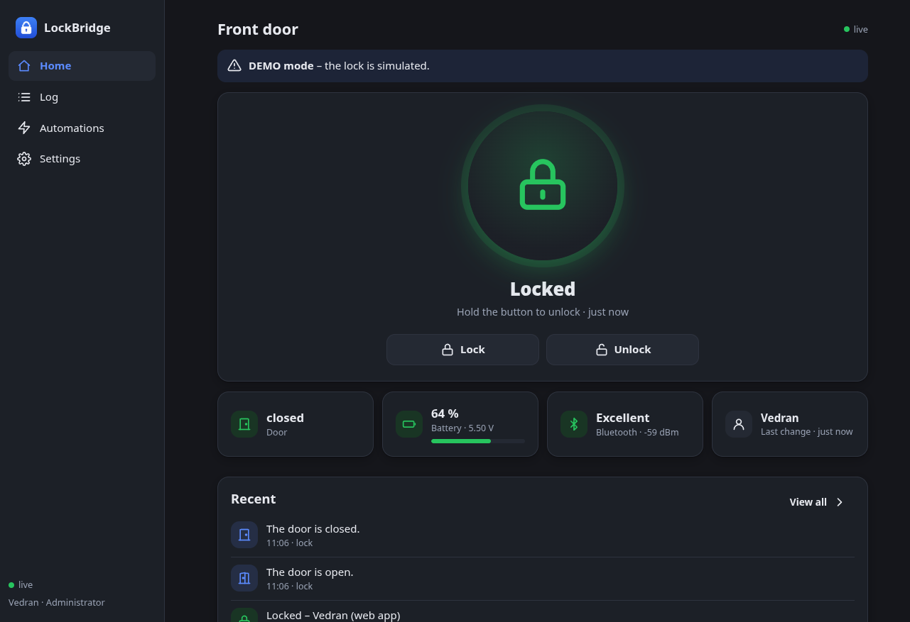
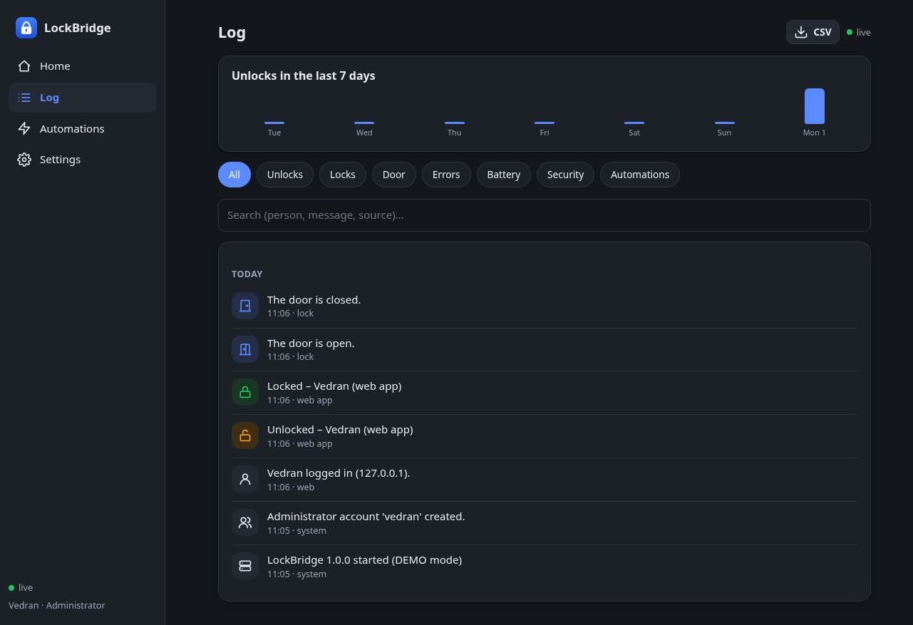
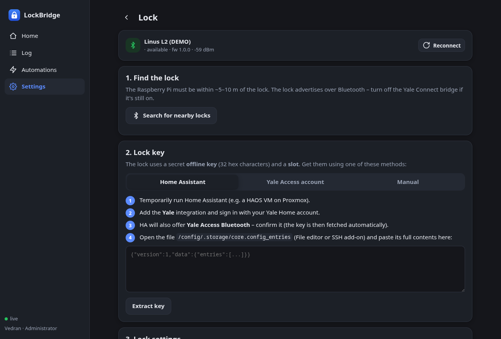
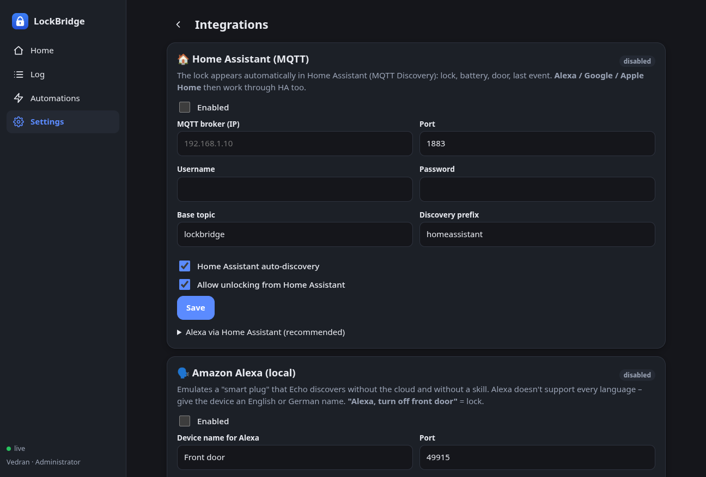
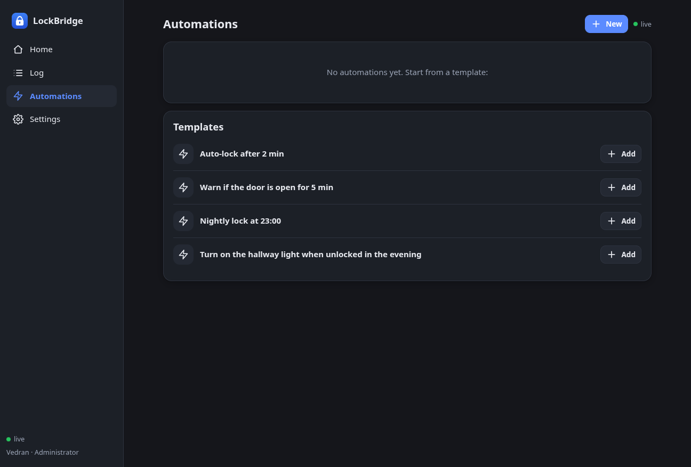
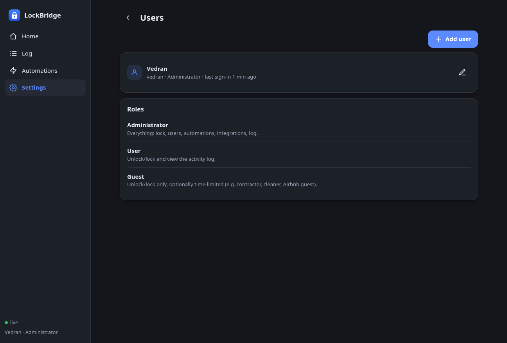
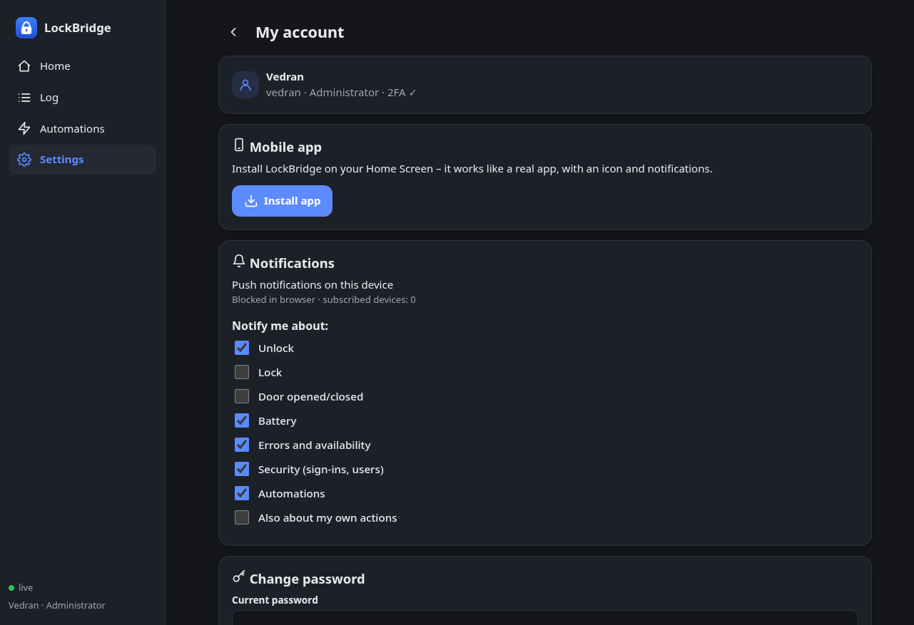
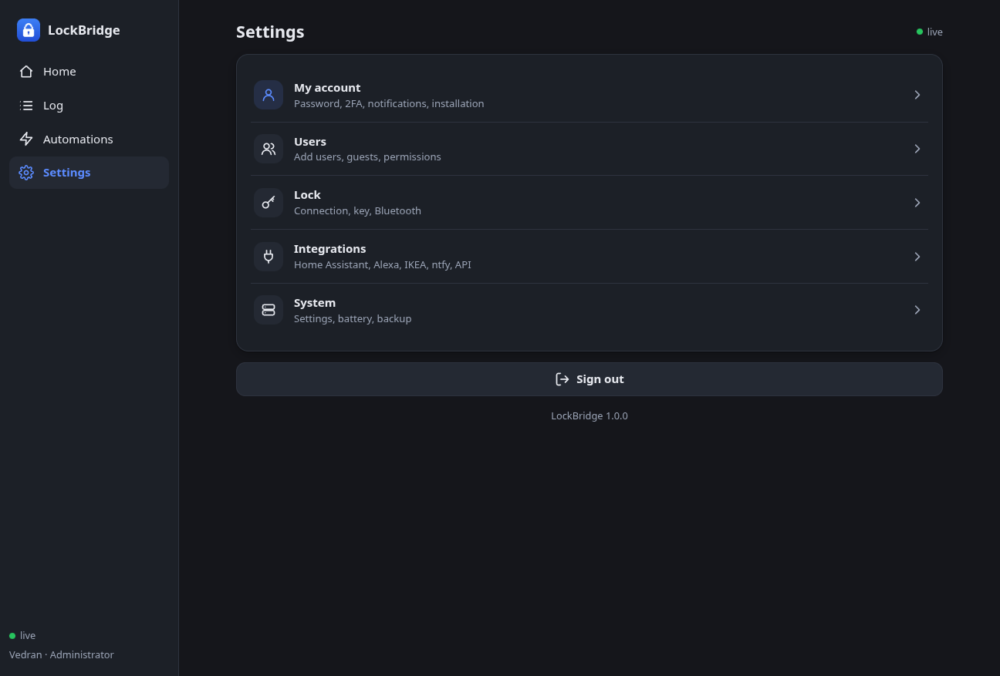

# Yale LockBridge

**A local, cloud-free bridge between your Yale/August smart lock and a web app on your phone.**

LockBridge turns a Raspberry Pi into a Bluetooth bridge for Yale and August locks. The Pi talks to the lock directly over BLE, using the same offline key that the official app uses, and serves a small web app (installable as a PWA) on your LAN or through your own Cloudflare Tunnel.

No vendor cloud is used at runtime. No account, no subscription, no third-party server.

```
  You and your family (phone, PWA) ──HTTPS──► Cloudflare Access (your e-mails only)
                                                   │ Cloudflare Tunnel
                                                   ▼
                          your existing cloudflared (any machine on the LAN)
                                                   │ http://PI-IP:8080
  Home Assistant / Alexa / IKEA (LAN) ────────────►▼
                                        Raspberry Pi (LockBridge)
                                                   │ Bluetooth LE (~5–10 m)
                                                   ▼
                                             Yale / August lock
```

---

## Features

- **Lock / unlock / unlatch** from a phone, with hold-to-unlock protection
- **Multi-user** with roles (admin, user, guest) and time-limited guest access
- **Mandatory TOTP 2FA** for every account
- **Activity log**: who opened the door and when, plus battery, door and error events, CSV export
- **Battery alerts** with warning and critical thresholds
- **Automations**: auto-lock, night lock, "door left open" alerts, IKEA lights, webhooks, MQTT
- **Integrations**: Home Assistant (MQTT discovery), Alexa, IKEA DIRIGERA, ntfy, Telegram, REST API
- **PWA**: installs on Android and iOS, with push notifications (including a "Lock" action button)
- **Guided installer**: detects Home Assistant, fetches the offline key from the Yale cloud, pairs the lock

---

## Screenshots

| | |
|---|---|
|  |  |
| **Home** — lock state, door, battery, Bluetooth signal and the last event. Unlock requires holding the button. | **Activity log** — who opened the door and when, with filters, a 7-day chart and CSV export. |
|  |  |
| **Guided lock setup** — find the lock over Bluetooth, then fetch the offline key from Home Assistant, the vendor cloud, or enter it manually. | **Integrations** — Home Assistant over MQTT (with auto-discovery), local Alexa, IKEA DIRIGERA, ntfy, Telegram and API tokens. |
|  |  |
| **Automations** — auto-lock, night lock, "door left open" warnings, lights, webhooks and MQTT, from ready-made templates. | **Users and roles** — admins, users and time-limited guests; 2FA is mandatory for everyone. |
|  |  |
| **My account** — install the PWA, choose which events trigger push notifications, change password. | **Settings** — everything in one place, including system settings and encrypted-at-rest backups. |

## How it works

1. **Pair once.** The wizard finds the lock over Bluetooth and fetches its offline key from your Yale account (through Home Assistant). From then on the key stays on the Pi.
2. **The Pi talks BLE.** It keeps a low-power scan running and opens an encrypted connection to the lock only when it needs to read the state or send a command.
3. **You use the phone.** The web app is a PWA: it installs to the home screen, keeps a live connection to the Pi and receives push notifications.
4. **Everything stays local.** Commands never leave your network unless you enable remote access, and then only through your own Cloudflare Tunnel with Access in front.

---

## Supported locks

LockBridge uses [`yalexs-ble`](https://github.com/bdraco/yalexs-ble), the same library as Home Assistant's *Yale Access Bluetooth* integration. If your lock works with that integration, it works here.

**Fully supported**

| Model | Device |
|---|---|
| YRD216 / YRL216 | Yale Assure Lock (keypad) |
| YRD226 / YRL226 | Yale Assure Lock (deadbolt / lever) |
| YRD256 | Yale Assure Lock (keypad) |
| YRD420 / YRD450 | Yale Assure Lock 2 |
| YUR/SSDL/1/*, YUR/DEL/1/* | Yale Unity (Australia) |
| IES-D210W-G0, YRSM-1 | Yale Smart Safe |
| ASL-05 | August Wi-Fi Smart Lock (4th gen) |
| ASL-03 | August Smart Lock Pro (3rd gen) |
| ASL-02 | August Smart Lock Pro (2nd gen) |
| **ASL-06** | **Yale/August lock with Yale Access module — tested by this project** |

**Limited support** (lock/unlock works, state updates do not)

| Model | Device |
|---|---|
| MD-04I | Yale Conexis L1 / L2 (requires a Yale Access module) |
| YRCB-490 | Yale Smart Cabinet Lock |

**Requirements for the lock**

- A **Yale Access Bluetooth module** (built in on most models above, add-on for others)
- The **offline key and slot** for your lock. The wizard fetches them from your Yale Home / Yale Access / August account through Home Assistant. See [Getting the offline key](#getting-the-offline-key).
- The old **Yale Connect bridge must be unplugged**: the lock accepts only one BLE connection at a time.
- Only one BLE client at a time. Do not run Home Assistant's *Yale Access Bluetooth* against the same lock while LockBridge is connected.

---

## Requirements

**Hardware**

| | Recommendation |
|---|---|
| Board | **Raspberry Pi 5** or **Raspberry Pi 4** (2 GB+). Any 64-bit Linux with BlueZ works. |
| Storage | 16 GB+ microSD. A **USB SSD** is strongly recommended for 24/7 use. |
| Power | Official PSU (Pi 4: 15 W USB-C, Pi 5: 27 W USB-C PD). Weak power causes unstable Wi-Fi/Bluetooth. |
| Cooling | Pi 5: official Active Cooler or a metal heatsink. |
| Network | **Ethernet** if possible: Wi-Fi and Bluetooth share the radio, and BLE is more stable when Wi-Fi is idle. |
| Placement | Within **5–10 m** of the lock, ideally without thick walls. |
| Optional | USB Bluetooth adapter with an antenna if the signal is weak (selectable in Settings → Lock). |

**Software**

- Raspberry Pi OS Lite 64-bit (Trixie or Bookworm), or any Debian 12/13 / Ubuntu 24.04+ with BlueZ
- Python 3.11+
- `bluez`, `rfkill`

**Optional**

- Home Assistant (only needed once, to fetch the offline key — it can be a temporary install)
- A domain on Cloudflare with a Tunnel + Access, for remote access without opening ports
- Cloudflare is **not** required: the app works fine on the LAN

---

## Quick start

```bash
# on the Pi
git clone https://github.com/geekranius/yale-lockbridge.git
cd yale-lockbridge
sudo ./install.sh --wizard
```

The installer sets up Python, BlueZ, a systemd service and a dedicated system user, then runs the guided wizard:

1. **System check** — board, OS, Python, Bluetooth adapter
2. **Home Assistant** — auto-discovers HA on the LAN; if there is none, offers to install **Home Assistant Container** on the Pi, or to enter the key manually
3. **Yale login** — starts the OAuth flow and waits for you to sign in with the Yale Home account that owns the lock
4. **Offline key** — fetched from the Yale cloud automatically and stored separately from the database
5. **Bluetooth** — scans for the lock, matches it against your account, shows the signal strength
6. **Save & start** — writes the config and restarts the service

When it finishes, open `http://PI-IP:8080` and create the admin account (password + TOTP 2FA).

Non-interactive runs (automation, Ansible):

```bash
sudo ./install.sh \
  --ha-url=http://192.168.1.10:8123 \
  --ha-token=eyJ... \
  --public-url=https://lock.example.com
```

### Manual install

```bash
cd yale-lockbridge
sudo ./install.sh
# then, to configure the lock later:
sudo lockbridge-setup
```

---

## Getting the offline key

The lock is operated with an **offline key** (32 hex characters) and a **slot** number, provisioned by the vendor app. LockBridge needs them once.

The wizard handles this for you:

- If Home Assistant is **on the same machine** (e.g. the HA Container option), the wizard reads the key directly.
- If Home Assistant is **remote**, the wizard uses your long-lived token to talk to it. You still need the key file once: the wizard can read it over SSH (`--ha-ssh user@host`), from a local path (`--ha-storage`), or you can paste the contents of `/config/.storage/core.config_entries`.
- If you already have the key, `--manual-key` + `--slot` sets it directly.

Where the key comes from in Home Assistant:

1. *Settings → Devices & services → Add integration → **Yale*** (or **August** for US accounts)
2. Sign in with the account that owns the lock
3. Home Assistant stores the offline key in the Yale integration
4. The wizard reads `/config/.storage/core.config_entries` and calls the Yale API with the OAuth token to fetch the key

> The key stays valid until you remove and re-add the lock in the Yale Home app. If you do that, run the wizard again.

---

## Remote access with Cloudflare (optional, recommended)

You never open port 8080 on your router. All remote traffic goes through your existing `cloudflared` and Cloudflare Access.

1. **DNS / tunnel** — Zero Trust → Networks → Tunnels → your tunnel → **Public hostname**:
   - Subdomain `lock`, your domain, service **HTTP**, URL `PI-IP:8080`
2. **Access application** — Zero Trust → Access → Applications → *Self-hosted*:
   - Domain `lock.yourdomain.tld`
   - Session duration: 1 month
   - Identity provider: One-time PIN and/or Google
   - Policy **Allow** → **Emails** → only your family
3. **PWA icons** — a second Access application with **Bypass / Everyone** for:
   - `lock.yourdomain.tld/static/icons`
   - `lock.yourdomain.tld/manifest.webmanifest`
   (only images and the manifest — no data)
4. Copy the **Application Audience (AUD) tag** and enable the in-app check:

```bash
sudo ./install.sh \
  --cf-team=yourteam \
  --cf-aud=AUD_TAG \
  --cf-emails=you@example.com,family@example.com \
  --proxy-ip=IP-OF-CLOUDFLARED-MACHINE \
  --public-url=https://lock.yourdomain.tld
```

With Cloudflare enabled, LockBridge verifies the Access JWT (signature, audience, team and e-mail list) on **every** request. Direct LAN access is refused by design. Even a misconfigured Access policy does not let strangers in.

---

## The phone app

LockBridge is a PWA — no app store.

- **Android (Chrome):** open the HTTPS address → *Install app*
- **iPhone (iOS 16.4+):** open in **Safari** → Share → *Add to Home Screen* → open it from the home screen → *Settings → My account → Enable notifications*

Installation and push notifications require **HTTPS**. On plain `http://` the browser disables both; the app shows a QR code for the HTTPS address instead.

Push notifications are delivered by Google/Apple and do not depend on the Cloudflare session. The "🔒 Lock" button in the notification works while the Access session is valid.

---

## Integrations

### Home Assistant (MQTT)

1. Install the **Mosquitto broker** add-on and the **MQTT** integration in HA
2. In LockBridge → *Integrations → Home Assistant*: HA IP, MQTT user and password

Entities appear automatically: lock, battery, door, last event, Bluetooth signal.

Topics (`lockbridge` base):

- `lockbridge/lock/set` — `LOCK` / `UNLOCK` / `OPEN`
- `lockbridge/lock/state`, `lockbridge/door`, `lockbridge/battery`, `lockbridge/event` (JSON)

### Alexa

- **Recommended:** through Home Assistant (Nabu Casa or a manual skill) — the lock appears as a real lock and voice unlock asks for a PIN
- **Local, no cloud:** *Integrations → Alexa* emulates a smart plug. Then "Alexa, discover devices".
  - "Alexa, turn off front door" = lock
  - Voice unlock is **off by default** (someone could shout through the door)

### IKEA DIRIGERA

*Integrations → IKEA*: hub IP, **Pair**, press the button on the hub. Use lights/scenes in automations, or an IKEA button (RODRET, SOMRIG, STYRBAR) as a trigger.

### REST API

*Integrations → API tokens → New token*. From the LAN (with `--lan`) use `http://PI-IP:8080`; from outside you also need a Cloudflare **Access Service Token**.

```bash
curl -X POST -H "Authorization: Bearer TOKEN" \
  -H "CF-Access-Client-Id: ID" -H "CF-Access-Client-Secret: SECRET" \
  https://lock.example.com/api/unlock
```

Other endpoints: `POST /api/lock`, `POST /api/unlatch`, `GET /api/status`, webhook triggers `/api/hook/...`.

---

## Security

See **[SECURITY.md](SECURITY.md)** for the full threat model.

Short version:

- **Layered access**: Cloudflare Access (e-mail code) → password → TOTP 2FA, plus an independent in-app JWT check
- **The offline key is never exposed**: no API returns it, it is stored in a separate `0600` file outside the SQLite database, so it does not appear in downloads, backups or logs
- **Defence in depth**: CSRF tokens, login rate limiting, `scrypt` password hashing, strict security headers, systemd sandboxing
- **No inbound ports**: remote access only through your own Cloudflare Tunnel

No software can promise 100 % security once an attacker has full control of the host. What LockBridge guarantees is that a compromise of the *web layer* does not hand over the key: the key is not in the web data model, not in any response, and not in any export. Full host/root compromise is out of scope for every self-hosted app — protect the device (SSH keys, updates, physical access).

---

## Configuration reference

`/etc/lockbridge.env` (read by systemd):

| Variable | Meaning |
|---|---|
| `LB_PORT` | HTTP port (default `8080`) |
| `LB_CF_TEAM` | Cloudflare Zero Trust team name |
| `LB_CF_AUD` | Application Audience tag |
| `LB_CF_EMAILS` | Comma-separated allowed e-mails |
| `LB_PROXY_IPS` | Comma-separated IPs of the `cloudflared` host(s) |
| `LB_CF_LAN_BYPASS` | `1` = allow direct LAN access without Access (not recommended) |
| `LB_PUBLIC_URL` | Public HTTPS URL (used for the install QR code) |

After editing: `sudo systemctl restart lockbridge`.

Administration:

```bash
sudo lockbridge-admin users
sudo lockbridge-admin reset-2fa <user>
sudo lockbridge-admin reset-password <user>
```

---

## Troubleshooting

| Problem | Fix |
|---|---|
| "Lock unavailable" | Move the Pi closer to the lock, use Ethernet, plug in a USB BT adapter, check the lock batteries, unplug the old Yale Connect bridge. |
| "Lock rejected the key" | Wrong key or slot, or the lock was re-added in the Yale Home app. Re-run the wizard. |
| No install button / no notifications | The page must be opened over **https://**, and on iPhone in Safari. Check the Bypass app for icons. |
| `403 – access allowed only through Cloudflare Access` | Team, AUD or e-mail in `/etc/lockbridge.env` do not match the Access application. `journalctl -u lockbridge \| grep Access` |
| Cloudflare 502 | `cloudflared` cannot reach the Pi: check IP/port in the public hostname and that the Pi is up. |
| Bluetooth scanner not working | `bluetoothctl list` must show `hci0`; `sudo rfkill unblock bluetooth && sudo systemctl restart bluetooth lockbridge`. On Pi 5 make sure `dtoverlay=disable-bt` is not in `/boot/firmware/config.txt`. |
| BLE stutters while Wi-Fi is busy | Use Ethernet, or `sudo iw dev wlan0 set power_save off`. |
| Logs | `journalctl -u lockbridge -f` |

---

## Development

Run without hardware (simulated lock):

```bash
python3 -m venv .venv && .venv/bin/pip install -r requirements.txt
LB_DEMO=1 LB_DATA_DIR=./demo-data .venv/bin/python -m lockbridge
```

Then open <http://localhost:8080>.

---

## Limitations

- **Who unlocked:** unlocks through LockBridge (web, API, HA, Alexa, automations) record the exact person. Unlocks with a key, thumb-turn, keypad or the Yale app only record the **source** (e.g. "keypad / PIN, user #3"), not the name.
- Uses [`yalexs-ble`](https://github.com/bdraco/yalexs-ble). If your lock works with Home Assistant's *Yale Access Bluetooth*, it will work here.
- Yale can change its cloud; fetching the key depends on it. Once the key is stored, everything runs locally.
- One BLE connection at a time. Do not run another integration against the same lock simultaneously.

---

## License

MIT — see [LICENSE](LICENSE).

Not affiliated with Yale, ASSA ABLOY or August Home. Use at your own risk; you are responsible for your own door.
